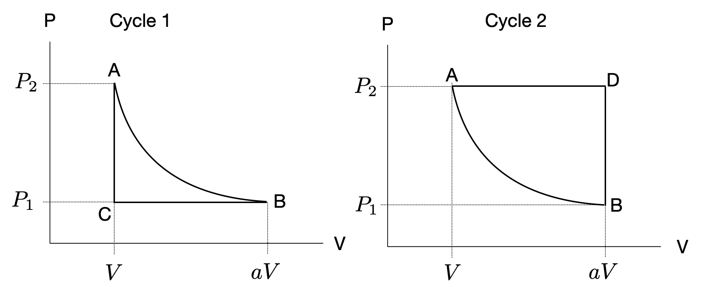

# Chapters 4 - 6

### Problem 1

The figure below shows two cycles which operate between volumes $V$ and $aV$ ($a > 1$), and pressures $P_{1}$ and $P_{2}$. Points $A$ and $B$ are the same in both diagrams, and the process connecting them is adiabatic (zero heat transfer $Q = 0$). The other legs of the cycle occur at constant pressure and at constant volume, as indicated on the diagrams. The working substance is the same for both cycles, and has adiabatic exponent $\gamma = C_{P}/C_{V}$.

**(a)** Draw arrows indicating which direction along each cycle one must take in order for the net work done by the gas to be positive.

**(b)** During which cycle will the gas do more work: Cycle 1, Cycle 2, or are they the same?

**(c)** Find the ratio of the minimum temperature and maximum temperature for both cycle 1 and cycle 2. If they were reversible cycles, which would have the higher efficiency? Your answers should be expressed only in terms of the expansion factor $a$ and the adiabatic exponent $\gamma$. (Hint: compare Carnot efficiencies.)

**(d)** Now assume each leg of both cycles occurs in a different reservoir. You can no longer use the Carnot theorem to compute the efficiency. To find the efficiency in this setting, you must first find the heat which flows into the gas. For this part, compute the heat which flows into the gas for each cycle, and indicate along which stages the gas absorbs this heat. You may express your final answer in terms of (not necessarily all of) the following variables: temperatures $T_{A}$, $T_{B}$, $T_{C}$, $T_{D}$, heat capacities $C_{P}$, $C_{V}$, volume expansion factor $a$, and $\gamma$.

**(e)** Now calculate the heat which is lost by the gas during each cycle, i.e. the heat outflow. Again, indicate along which stages the gas loses heat. You may express your final answer in terms of (not necessarily all of) the following variables: temperatures $T_{A}$, $T_{B}$, $T_{C}$, $T_{D}$, heat capacities $C_{P}$, $C_{V}$, volume expansion factor $a$, and $\gamma$.

**(f)** Combine your results for (d) and (e) to compute the efficiency of each cycle. Now, your answer should be written only in terms of the expansion factor $a$ and the adiabatic exponent $\gamma$. Take the limit of large $a$ to determine which cycle is more efficient.

***

### Problem 2

The partition function for a van der Waals gas has the form

$$
Z = f(N,T)\,(V - N b)^{N} e^{aN^{2}/V k T},
$$

where $f(N,T)$ is a function of $N$ and $T$, but not of volume. The constant $b$ determines an excluded volume around each particle, and $a$ represents an attractive force between particles. Use this to derive the van der Waals equation of state, which gives the relation between pressure, volume, temperature, and number of particles. Show that you recover the ideal gas law when $a = b = 0$.

***

### Problem 3

Consider two dipoles which have configurations $s_{1} \in \{-1, +1\}$ and $s_{2} \in \{-1, +1\}$. The energy of a given configuration is

$$
E(s_{1}, s_{2}) = -J s_{1} s_{2}.
$$

**(a)** Compute the partition function for this system at temperature $T$.

**(b)** What is the entropy in the limit $T \to 0$ and $T \to \infty$? You can obtain this in any way you like, but explain your reasoning.

***

### Problem 4

Consider three dipoles whose energy is given by

$$
E(s_{1}, s_{2}, s_{3}) = J s_{1} s_{2} + J s_{2} s_{3} + J s_{3} s_{1}.
$$

This is a simple example of a frustrated system: $s_{1}$ wants to anti-align with $s_{2}$, which will minimize $J s_{1} s_{2}$ by making it negative. And $s_{2}$ wants to anti-align with $s_{3}$, making $J s_{2} s_{3}$ negative. But there is no configuration which can minimize these first two terms and also minimize the last term $J s_{3} s_{1}$. Find the entropy of this system at zero temperature. You can use any approach you like.
